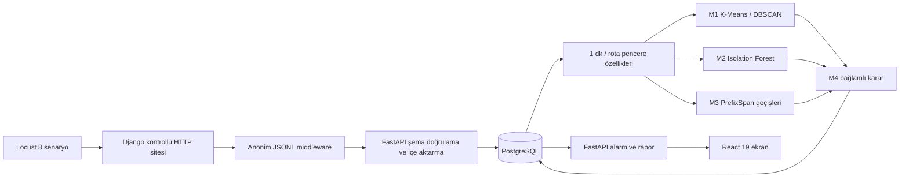

# LogScope · Ana Mimari ve Kodların Sorumlulukları

Bu proje ders öneri formundaki soruya cevap verir: **HTTP istek hacmine eklenen rota/saat bağlamı ve oturum örüntüsü sinyali, anomali tespitinde yanlış alarmları azaltıyor mu?**

## Modül sorumlulukları

| Bileşen | Sorumluluk | Geliştirme adresi |
|---|---|---|
| Django | Kontrollü trafik sitesi, istek şablonları, anonim JSONL log üretimi | `127.0.0.1:8001` |
| Locust | 4 normal + 4 sapma senaryosunu, sadece kendi Django servisimiz üzerinde çalıştırmak | `127.0.0.1:8089` |
| FastAPI | Giriş, kayıt, CRUD, JSONL alımı, analiz sonuçları ve raporlar | `127.0.0.1:8000` |
| PostgreSQL | Canonical araştırma verileri ve arayüz operasyonel kayıtları; migration bekliyor | `127.0.0.1:5432` |
| React | 19 ekranlık arayüz, kullanıcı işlemleri, dashboard ve API tüketimi | `127.0.0.1:5173` |
| M1–M4 | M1 trafik kümesi, M2 IF, M3 rota dizisi, M4 birleşik skor | `backend/analysis.py` |

## Veri akışı (planlanan entegre sistem)

## Önce yapılacak küçük iş ve kabul ölçütü

**İlk kod adımı:** Django HTML uygulamasını çalıştır ve farklı rotalara ziyaret yap. `django_demo/generated_access.jsonl` oluşmalı. Her satır `event_uid`, `occurred_at`, `http_method`, `route_template`, `status_code`, `duration_ms`, `session_ref`, `schema_version` alanlarından oluşmalı. Ham IP, parola, token, çerez, query ve gövde bulunmamalı. Locust kullanıcıları sentetik UUID ile oturum sürekliliği sağlamalı.

**İkinci kod adımı:** FastAPI'yi başlat, Swagger'dan `/api/health` çağır. Sonra React'i başlat, giriş/alarmlar/raporlar akışını dene.

**Üçüncü kod adımı:** PostgreSQL'i başlat; 27 tablo canonical araştırma şemasının gerçekten oluştuğunu psql/pgAdmin ile kontrol et. Şu anda API operasyonları `ui_*` adaptör tablolarını kullanıyor. **Bunların canonical veri modeline dönüştürülmesi henüz bitmedi.**

**Dördüncü kod adımı:** JSONL aktarımı -> pencereler -> M1–M4 -> alarm -> panel zincirini Locust gerçek istekleriyle, etiket bilgisi test kümesine sızmadan ölç.

## Hangi hedefler henüz gerçekleştirilmiş sayılmaz?

F1 >= 0,80; normal FPR <= %5; 20 eşzamanlı kullanıcıyla API p95 <800 ms; panel p95 <=15 sn; 5 senaryo tohumu ve %95 güven aralığı **hedef olarak durur**. Bunlar tamamlandı denebilmesi için kayıtlı deney sonuçları, karışıklık matrisi ve yük testi gerekir.

## Güvenlik ve ölçekleme sınırları

Bu repo yalnızca yerel eğitim ve prototip içindir. Demo auth, CSRF, hız limiti, üretim sırrı yönetimi, sağlam multi-tenant yetkilendirme, veri silme politikaları ve migrasyon stratejisi canlı bir hizmet için gözden geçirilmelidir. `LOGSCOPE_ENABLE_ANOMALY_ENDPOINTS=1` yalnızca localhost'ta kullanılır.
